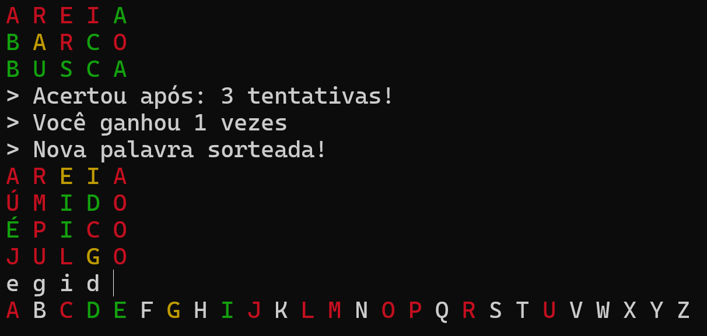

# Termonal

Um jogo de adivinhar palavras de 5 letras, inspirado no Termo, mas que roda offline direto no terminal, utilizando Python.

## Como jogar

Ao iniciar ou ganhar uma rodada, uma palavra é sorteada automaticamente. 
Escreva uma palavra de 5 letras para fazer seu chute. 
A cada chute as letras do chute e do alfabeto ficam coloridas:

- **verde**: a letra está na palavra e na posição correta.
- **amarelo**: a letra está na palavra, porém na posição errada.
- **vermelho**: a letra não está na palavra.

 

Na linha de baixo fica o alfabeto para referência, onde você pode ver as letras já jogadas e suas respectivas cores descobertas até o momento, branca caso a letra não tenha sido testada ainda.

O jogo trata acentos, unifica 'Ç' e 'C', letras maiúsculas e minúsculas, e aceita espaços entre as letras do chute, para que você possa escrever de várias formas sem problemas.

Possui um contador de tentativas e partidas ganhas enquanto o jogo está aberto.

### Comandos especiais

- '999': encerra o jogo.
- 'mostrar': revela a palavra secreta, porém a rodada é desconsiderada.

## Como rodar

### Windows (.exe)
Baixe o [termonal.exe na página de Releases](https://github.com/Odahvin/Termonal/releases/latest) e dê dois cliques. Não é preciso instalar mais nada.

### Com o Python (Windows, Mac e Linux)
1. Instale o Python
2. Baixe o .zip do projeto (botão verde **Code** -> **Download ZIP**) e extraia em qualquer pasta. Os arquivos `termonal.py` e `termonal-palavras.txt` precisam ficar na mesma pasta.
3. Abra o terminal na pasta escolhida e execute: `python termonal.py` (no Mac e no Linux, pode ser `python3 termonal.py`)

### Notas

O 'termonal-palavras.txt' possui cerca de 10 mil palavras, uma por linha, em minúsculo. 
Se escolher a versão .zip, você pode substituir por outro txt com o mesmo nome e seguindo as mesmas regras.

Este é um projeto independente, não tem relação com o Termo ou qualquer outro jogo parecido.

### Licenças

O código do Termonal é distribuído sob a licença MIT.

A lista de palavras `termonal-palavras.txt` é derivada de [pythonprobr/palavras](https://github.com/pythonprobr/palavras), licenciada sob a [Mozilla Public License 2.0](https://www.mozilla.org/MPL/2.0/), e continua sob essa mesma licença (texto em `LICENSE-palavras.txt`). Foi filtrada e modificada com acréscimos e remoções manuais.
